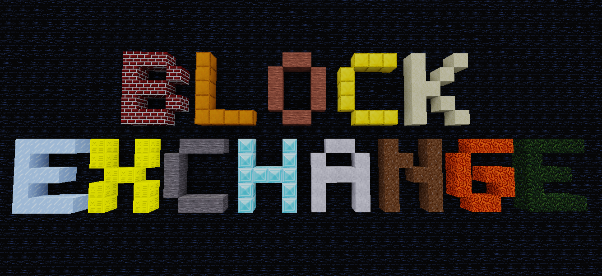

Luanti blockexchange mod


[](https://coveralls.io/github/blockexchange/blockexchange?branch=main)
[](license.txt)
[](https://content.minetest.net/packages/BuckarooBanzay/blockexchange)

# Overview

The `blockexchange` mod allows you to share and use your builds across different worlds.
It uses a central (configurable) server to exchange schemas (builds) of near infinite size.

The server part lives at https://github.com/blockexchange/blockexchange_server and can be self-hosted.

Schemas can be browsed and administered on the central server: https://bx.luanti.ch



# Basic usage

## Download

* Start your Luanti app
* Download the `blockexchange` mod in the "Content" tab from the ContentDB.
* Add the `blockexchange` mod to the secure HTTP-Mods settings (search for "http" in the "settings" tab)
* Create a new world and activate the mod
* Grant yourself the needed privs with `/grantme blockexchange`
* Search for an empty place and mark it with `/bx_pos1`
* Browse online for a schema at https://bx.luanti.ch
* Load the schema with the `/bx_load <username> <schemaname>` command (**WARNING**: this may place the schema over existing builds!)
* Have fun!

## Upload

* Start your Luanti app
* Download the `blockexchange` mod in the "Content" tab from the ContentDB.
* Add the `blockexchange` mod to the secure HTTP-Mods settings (search for "http" in the "settings" tab)
* Create a new world and activate the mod
* Grant yourself the needed privs with `/grantme blockexchange`
* Build a thing
* Set positions on the opposite corners with `/bx_pos1` and `/bx_pos2`
* Login with an access token generated from https://bx.luanti.ch: `/bx_login [username] [access_token]`
* Save the schematic with `/bx_save <name>`

## Sync

Synced regions keep a build in sync with a remote schematic: local changes are tracked and uploaded as deltas
(only the changed nodes), remote changes are merged into the local build.

* Open the sync menu with `/bx_sync`
* **Upload selection**: uploads the marked area as new schematic (or links it to an existing schematic of the same size)
  and registers it as synced region
* **Download**: downloads a schematic as synced region (read-only, or read-write if you own it) or as one-off copy
* Inside a synced region `/bx_sync` shows its status with the local and remote changes:
  * **Push** uploads the local changes (with autosave enabled this happens automatically)
  * **Pull** downloads and merges the remote changes, nodes changed on both sides are conflicts that are resolved
    by keeping the local or the remote version
  * **Unlink** removes the sync information, the build stays in the world

Areas tracked with the previous area-tracking (`/bx_save_update`, `/bx_load_update`, `/bx_autosave`) are migrated
to synced regions without baseline: choose the authoritative side ("Remote wins" or "Local wins") in the status page.

# Chat commands

## Offline

Local commands, they don't need the http-api and make no calls "home"

* **/bx_hud [on|off]** enables or disables the blockexchange hud
* **/bx_pos1 [pos?]** mark position 1 (uses WE positions if available)
* **/bx_pos2 [pos?]** mark position 2 (uses WE positions if available)
* **/bx_cleanup** cleans up stray metadata and invalid param2 values
* **/bx_emerge** emerge the selected area
* **/bx_save_local [schematic-name]** saves a local schematic to `<worldmods>/bxschems`
* **/bx_load_local [schematic-name]** loads a local schematic from `<worldmods>/bxschems`
* **/bx_allocate_local [schematic-name]** allocates a local schema

## Online

Online commands, they call the remote-server with the http api

### Read-only

* **/bx** shows the info and settings menu
* **/bx_info** shows infos about the connected blockexchange server
* **/bx_license** sets or displays the license of your uploaded schematics (defaults to CC0)
* **/bx_load [username] [schematic-name]** load a schematic by name onto pos1
* **/bx_placer [username] [schematic-name]** creates a placement tool for the schematic
* **/bx_allocate [username] [schematic-name]** allocates a schematic by name
* **/bx_login [username] [access_token]** logs in with the username and token
* **/bx_cancel** Cancels an active job

### Write (needs a login)

* **/bx_save [schematic-name]** saves/uploads the selected area as a new schematic
* **/bx_sync** opens the sync menu (upload/download wizards, status of the synced region at your position)
* **/bx_sync status [id]** shows the status of a synced region
* **/bx_sync list** lists all synced regions
* **/bx_sync push [id]** uploads the local changes of a synced region
* **/bx_sync pull [mine|theirs] [id]** downloads and merges the remote changes (aborts on conflicts without `mine`/`theirs`)
* **/bx_sync autosave <on|off> [id]** toggles the automatic upload of local changes
* **/bx_sync unlink [id]** removes the sync information of a region (the build stays)
* **/bx_logout** logs out
* **/bx_login** shows the login status

# Privileges

* **blockexchange** can use the blockexchange commands (admin)
* **blockexchange_protected_upload** can upload self-protected areas (survival-compatible)

# Settings

* **blockexchange.url** URL to the central server
* **blockexchange.min_delay** min delay between http calls

The mod also needs the http api:
```
secure.http_mods = blockexchange
```

# Provisioning

If a `bx_provision.json` file exists in the world folder, the configured remote schematic is downloaded once
to the given position on the first player join:

```json
{
	"schema_uid": "a681b2e3-f44a-47e5-b862-5c4714709040",
	"position": { "x": 0, "y": 0, "z": 0 }
}
```

The download is repeated if the `schema_uid` or `position` changes.

Optional authentication fields:

* `username` and `access_token`: login with an access token (like `/bx_login`)
* `token`: a raw jwt token

If an authentication is provided, the schematic is placed in read/write mode: the player gets logged in
and the area is registered as synced region with autosave enabled, so changes are uploaded automatically.
The authenticated user has to be the owner of the schematic.

# Api docs

See: https://blockexchange.github.io/blockexchange/

# License

* Code: MIT

* Textures
    * `textures/blockexchange_button*png` CC0 https://opengameart.org/content/ui-pack
    * `textures/blockexchange_check*png` CC0 https://opengameart.org/content/ui-pack
    * Everything else: CC-BY-SA 3.0 (http://www.small-icons.com/packs/16x16-free-application-icons.htm)
